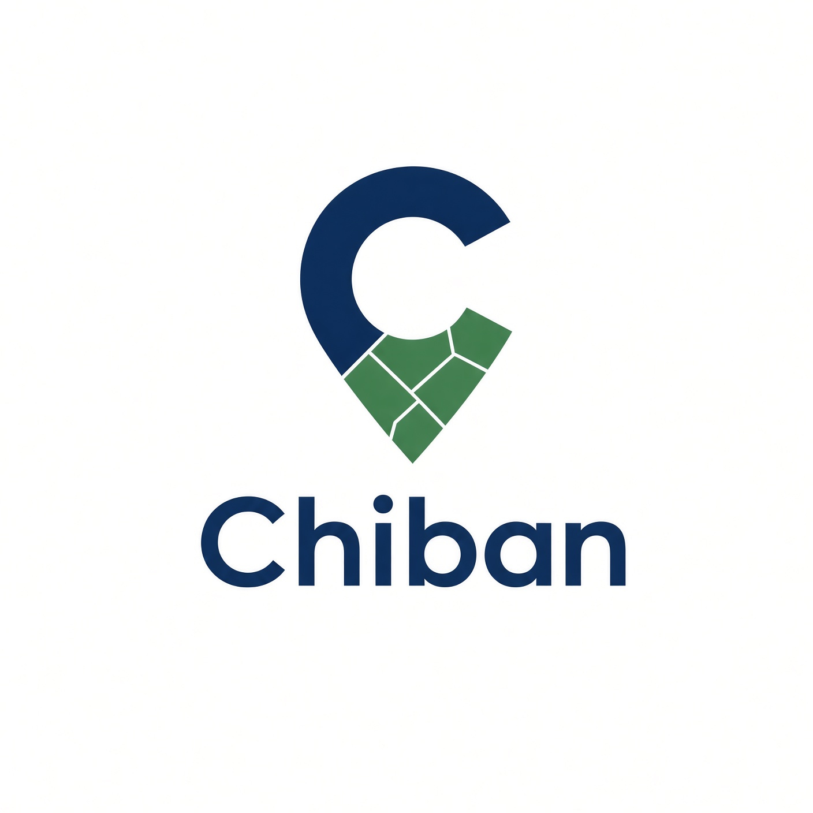
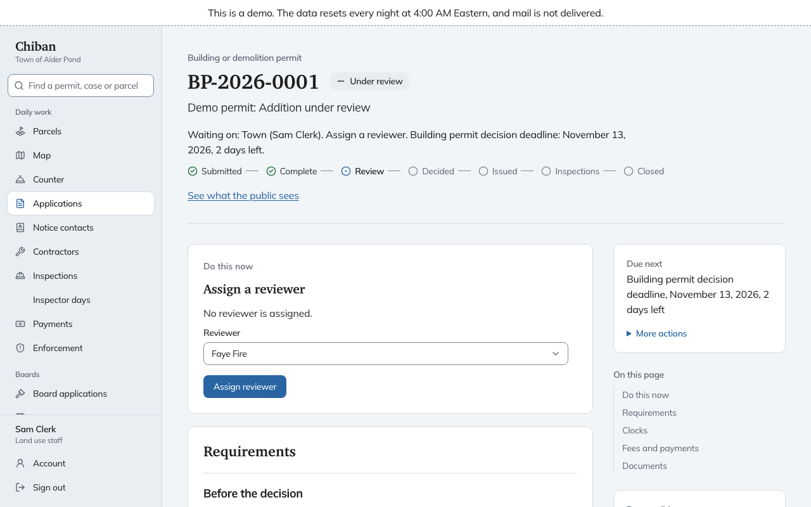
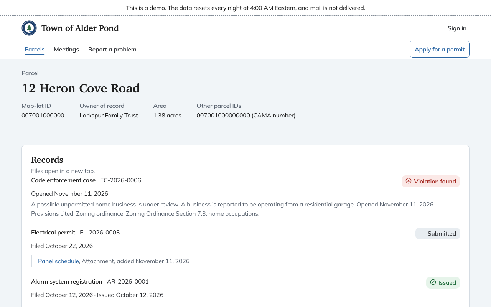
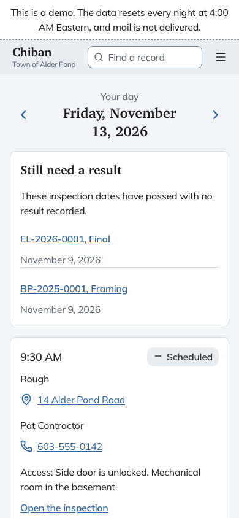

<p align="center">
  
</p>

<p align="center">
  <strong>Open-source land-use software for small US towns.</strong><br>
  Building and trade permits, inspections, Planning Board and ZBA applications, and code enforcement, all kept on the parcel.
</p>

<p align="center">
  <a href="https://demo.chiban.us/demo">Live demo</a> ·
  <a href="https://docs.chiban.us">Documentation</a> ·
  <a href="https://docs.chiban.us/operations/self-hosting/">Self-hosting</a> ·
  <a href="https://chiban.us">chiban.us</a>
</p>

<p align="center">
  <a href="LICENSE"></a>
  
</p>



## Why Chiban

A small town's land-use office is often one clerk, a part-time building inspector and two volunteer boards. Their work lives in paper files, a permit spreadsheet and deadlines that someone keeps in their head. Chiban puts the whole record of each parcel in one place: every application, notice, hearing, decision, permit, inspection and complaint, from the first form to the final certificate.

- **Organized around the parcel.** Open a lot and see everything that has happened to it. Residents can read the public part of that history without an account.
- **State rules built in.** Deadlines, notice wording, appeal routes and records-request rules come from a state pack. Each deadline shows the statute it runs on, the day it started and how it counts, so staff can defend it at the counter or in a hearing.
- **Staff configure it themselves.** Application forms, fees, permit conditions, document templates and notice wording are edited in the app, with no code and no support ticket.
- **The records stay the town's.** One export holds every record as plain text and every document as its original file, plus spreadsheet tables, an Excel workbook and a PDF/A copy of every PDF. A [written format guide](https://docs.chiban.us/reports-and-export/export-format/) lets a clerk or consultant read it without Chiban.
- **Free to run.** A town can host Chiban on its own server with Docker Compose, or pay someone to host it.

## What's in it

| Area | What staff and residents get |
|---|---|
| **Applications and permits** | Online and counter applications, departmental reviews, conditions, issuance, certificates and placards |
| **Inspections** | Booking slots, an inspector's day that works on a phone, checklists with photos, failed results and reinspections, calendar invites for each booking |
| **Boards** | Planning Board and ZBA cases, abutter notices, hearings, agendas, member packets, decisions and appeals |
| **Code enforcement** | Complaints (including anonymous ones that record nothing about the sender), cases, violations, orders and appeals |
| **Resident portal** | Parcel search, applying and paying online, following inspections, a contractor dashboard, records requests |
| **Payments** | Card payments online and at the counter through Stripe or Clover, plus cash and check |
| **Records** | Right-to-Know requests with exemptions and redaction, holds, the retention schedule, and an audit trail on every change |
| **Reports** | Permit volume, processing time, revenue, census reporting, scheduled reports and Excel downloads |
| **Moving in** | Imports from a CAMA export, GIS parcel layers, old permit spreadsheets and scanned property files (with OCR) |

<table>
  <tr>
    <td width="68%"></td>
    <td width="32%"></td>
  </tr>
  <tr>
    <td>The public parcel page</td>
    <td>An inspector's day on a phone</td>
  </tr>
</table>

## Try it

The [live demo](https://demo.chiban.us/demo) runs the fictional Town of Alder Pond, NH. Sign in as the clerk, the building inspector, a board member, an applicant, a contractor or the administrator, among others. The data resets every night and no mail goes out.

## Run it in your town

The [self-hosting guide](https://docs.chiban.us/operations/self-hosting/) sets Chiban up on a single Linux host with Docker Compose: Caddy, the app, a background worker, PostgreSQL with PostGIS, and Garage for object storage, with every image pinned by digest. Backups, restore checks, upgrades, outbound mail and card payments each have their own page in the same section.

The rest of the [documentation](https://docs.chiban.us) is written for the people who use Chiban every day: land use staff, inspectors, board members, the finance office, the records custodian and the administrator.

### State support

Chiban ships one state pack, **New Hampshire** (`packs/nh`). It holds the state's deadlines and holidays, notice and decision wording, appeal routes, building code editions, license types, parcel ID formats, Right-to-Know exemptions and records retention series. Adding a second state takes real work today. The [state pack guide](https://docs.chiban.us/state-packs/writing-a-pack/) explains how the New Hampshire pack is built and what another state would need.

## Built with

Next.js 16 and React 19, tRPC, Drizzle ORM on PostgreSQL 16 with PostGIS, MapLibre with vector tiles served from PostGIS, S3-compatible object storage, and pg-boss for background jobs. Tests run on Vitest, with an integration lane against a real PostGIS container, and Playwright.

## Development

### Prerequisites

- Node.js 24 or newer
- pnpm 9
- Docker with Compose (Postgres with PostGIS, Garage for S3-compatible object storage, and Mailpit run in containers)
- Ghostscript 10 on the PATH for PDF/A preservation (`brew install ghostscript` or `apt-get install ghostscript`)
- OCRmyPDF with the English Tesseract data on the PATH, only to migrate scanned legacy files (`brew install ocrmypdf` or `apt-get install ocrmypdf tesseract-ocr-eng`)

### Getting started

```bash
pnpm install
cp .env.example .env
```

Generate a secret key and put it in `.env` as the value for key `k1` in `CHIBAN_SECRET_KEYS`:

```bash
node -e "console.log(require('crypto').randomBytes(32).toString('base64'))"
```

Start the backing services, apply migrations, seed the fictional Town of Alder Pond, and run the app:

```bash
docker compose -f docker-compose.dev.yml up -d --wait
pnpm db:migrate
pnpm storage:init
pnpm db:seed:demo
pnpm dev
```

In a second terminal, start the background worker. `pnpm dev` runs only the web app. Without the worker, emails stay queued, exports never start and scheduled jobs never run:

```bash
pnpm worker
```

`pnpm db:seed:demo` can be run again on a seeded database. It adds only what is missing, and on a day with no demo counter payments or inspector stops it adds them for that day, so the Today views are never empty. Some demo data is only created on an empty database. To start over, `pnpm db:reset:demo` drops every table in the database that `DATABASE_URL` names, then migrates and seeds again. It refuses to run unless `ENABLE_DEV_SIGN_IN=true`.

The app serves on http://localhost:3000. Mailpit shows outgoing mail on http://localhost:8025. If another process holds host port 1025 or 8025, set `MAILPIT_SMTP_PORT` or `MAILPIT_UI_PORT` before `docker compose up` and match `SMTP_URL` in `.env`. Browsers upload files straight to object storage, and `pnpm storage:init` sets each bucket to accept uploads only from the origins in `S3_CORS_ORIGINS` (comma-separated), or from the origin of `BASE_URL` when that is unset. `.env.example` lists port 3000. The e2e run derives its own origin from `E2E_PORT` (default 4730), so it needs no entry. To serve the app from another origin, add it to `S3_CORS_ORIGINS` and run `pnpm storage:init` again.

### Dev sign-in

With `ENABLE_DEV_SIGN_IN=true` in `.env` and `NODE_ENV` other than `production`, http://localhost:3000/dev/sign-in lists the demo users (one per role, all at `alderpond.example`) and signs in as the one you pick.

To create a real staff account with a password and optional authenticator app:

```bash
pnpm staff:create --email you@example.test --name "Your Name" --role admin --password "a-long-password"
```

Then sign in at `/staff/sign-in` and enroll the authenticator at `/staff/account/totp`. Applicants and contractors sign in with an emailed link at `/sign-in`.

### Payment processors in development

No live processor key is configured anywhere in the repository. Stripe runs against `stripe-mock`, which the Compose file starts on port 12111. Set `STRIPE_API_BASE=http://localhost:12111` in `.env` (it is rejected when `NODE_ENV` is `production`) and save a Stripe account with the key `sk_test_123` at `/staff/settings/payments`. `stripe-mock` is stateless and sends no webhooks, so it checks request shapes and response parsing only.

Set `ENABLE_SIMULATED_PAYMENTS=true` to use the simulated processor, which backs the in-app checkout page and the counter card reader panel. Both say on screen that no live processor is connected. The Clover adapter runs against a local fake server (`pnpm clover:fake`) and has not been verified against a live merchant account.

### Address checks

Mailing address fields check what was typed against the USPS Addresses API v3 and show the standardized address under the field, with a "Use this" button that fills it in. The check runs on the server, and the browser never sees the credentials.

| Setting | Meaning |
|---|---|
| `USPS_CLIENT_ID` | Consumer Key of an app registered at developers.usps.com. Set it together with `USPS_CLIENT_SECRET`. |
| `USPS_CLIENT_SECRET` | Consumer Secret of the same app. |
| `USPS_API_BASE` | Defaults to `https://apis.usps.com`. Use `https://apis-tem.usps.com` for the USPS testing environment. |
| `USPS_STUB` | `true` answers from a local stand-in that capitalizes, shortens street words and adds a ZIP+4, so the suggestion can be tried without credentials. A street named Nowhere finds no match and a street named Slow runs past the timeout. Rejected when `NODE_ENV` is `production`. |

With neither credential set, the fields work as plain text fields and nothing is sent anywhere. When USPS is slow (over 2 seconds), fails, or finds no match, no suggestion is shown. Each signed-in person can make 30 lookups a minute, and repeated addresses are answered from a cache for a day.

### Checks

```bash
pnpm gate
```

Runs lint, typecheck, the unit lane (also under a west-of-UTC time zone), the integration lane against a real PostGIS container, and the term gate. Set `CHIBAN_TERMS_FILE` to the path of a banned-terms file to enable the term gate. It reports file and line only.

## Contributing

Issues and pull requests are welcome. Run `pnpm gate` before opening a pull request. Fixtures, seeds and examples use the fictional Town of Alder Pond, NH, so never commit a real town's names, parcel IDs, owners or addresses.

To report a security problem, email hello@chiban.us rather than opening a public issue.

## License

Chiban is licensed under the [GNU Affero General Public License v3.0](LICENSE).
